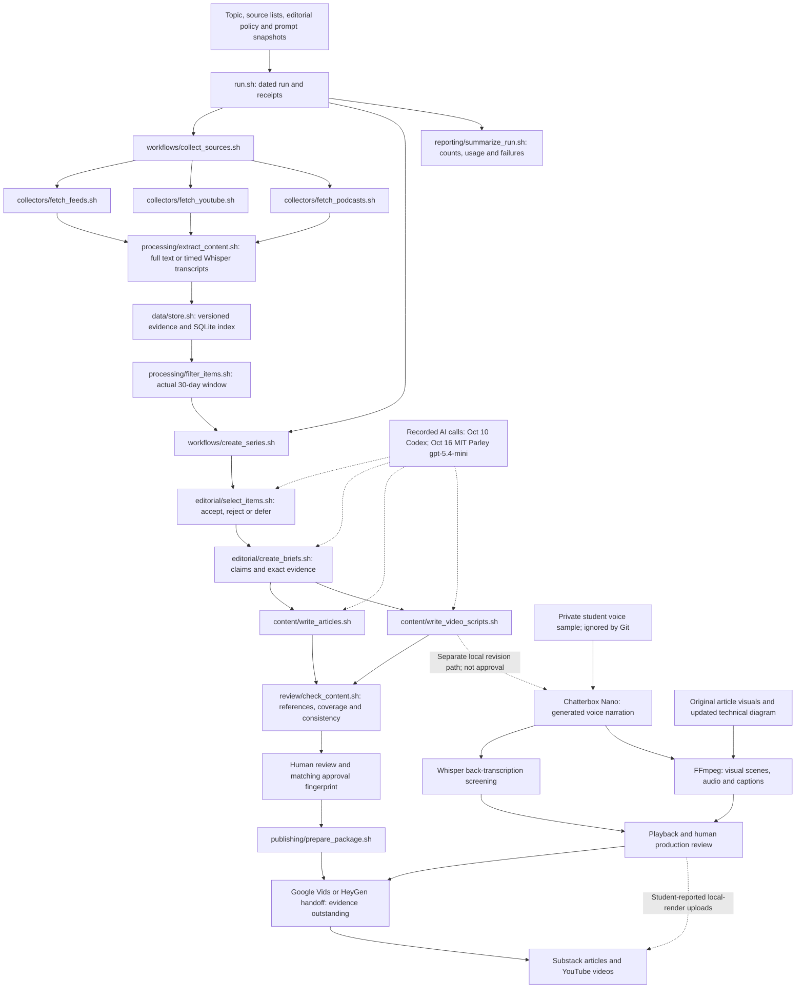

# Problem Set 4 Student Submission

**Student:** Student to complete

**GitHub repository:** https://github.com/harrrisw/ps04

**Deadline supplied:** Tuesday, October 13, 2026

**Status:** Pipeline implemented and tested; three October 10 article drafts and matching scripts pass mechanical checks, and the student has uploaded all three videos to YouTube (links below). Student feedback is recorded and implemented in policy version 3. Live collection ran again on October 16. All three Substack articles are published and accessible without sign-in. A 5:43 AI-narrated technical walkthrough is included. Final source verification, Google Vids/HeyGen production evidence, and editorial approval remain outstanding. October 16 work is after the supplied October 13 deadline.

The original course requirements are retained in [docs/ASSIGNMENT.md](docs/ASSIGNMENT.md),
and the required contracts remain in [ARCHITECTURE.md](ARCHITECTURE.md).

## Topic and Audience

- **Publication name:** The Small Business Research Brief
- **Topic:** AI tools for customer, competitor, and market research on a small-business budget.
- **Audience:** Market researchers, marketing generalists, and small-business owners who understand basic research methods but have limited budget, time, and technical support.
- **Central question:** Where can AI research tools save small businesses time while producing evidence reliable enough to guide decisions?
- **Scope:** Desk research, competitor monitoring, customer-feedback analysis, and interview/survey synthesis. Examine traceability, accuracy, cost, practical effort, and transfer to small-business conditions.
- **Exclusions:** Generic content generation, enterprise-only procurement, unsupported ROI claims, and synthetic respondents presented as observed customers.
- **Voice:** Practical, accessible, and skeptical of unsupported promotional claims.
- **Reason to return:** A recurring evidence check on which capabilities merit a small pilot and which claims still need validation.

## Published Series

The student supplied replacement YouTube links on October 17, 2026 for the
Chatterbox voice-cloned revisions. Anonymous YouTube oEmbed checks returned all
three titles and channel **Harris Wang**. Unlisted uploads are acceptable; full
external playback has not been independently checked.

The revised local videos run **4:21, 4:28, and 4:08** and passed full audio/video
decoding. Narration is AI-generated using the student's supplied voice recording.
Captions, scripts, upload descriptions, and checksums are in the
[revised delivery folder](deliverables/20261017-chatterbox/README.md).
Google Vids/HeyGen production remains undocumented.

The three Substack articles were accessible without sign-in on October 16.
Those earlier [access checks](docs/audit/publication_checks.json) verified links
to the original uploads. **Update the embedded video or video link in each
Substack article to the replacement URL below.** The local video revision retains
the October 10 evidence date and does not constitute another research run.

The [current review packet](runs/20261010T052912Z-1d2e8a/REVIEW.md) links all six
drafts and their supporting passages. [Assistant copy edits](runs/20261010T052912Z-1d2e8a/assistant_edits/20261010-copy-edit/README.md)
preserve original outputs and diffs; they are not student corrections or approval.

| Piece | Purpose | Substack article | YouTube video |
| --- | --- | --- | --- |
| 01 | What changed and why it matters | [Read article 01](https://mingxiwang.substack.com/p/pilot-the-evidence-trail-before-automating) | [Pilot the Evidence Trail Before Automating Competitor Research](https://youtu.be/IDsybf7UwEE) |
| 02 | Which claims withstand scrutiny | [Read article 02](https://mingxiwang.substack.com/p/make-ai-research-earn-its-place-with) | [Make AI Research Earn Its Place With Evidence You Can Check](https://youtu.be/7iR-6_BBqYQ) |
| 03 | Implications and what to watch | [Read article 03](https://mingxiwang.substack.com/p/pilot-one-customer-question-and-count) | [Pilot One Customer Question and Count the Work Needed to Trust the Answer](https://youtu.be/8oNRSNaHDDU) |

The upload mapping and verification scope are retained in
[current publication_links.json](deliverables/20261017-chatterbox/publication_links.json); the historical mapping remains preserved with the October 10 run.
Uploading the local renders does not by itself document Google Vids/HeyGen production.

**Separate technical demonstration:** [Watch/download the 5:43 AI-narrated walkthrough](deliverables/technical-demo/technical-demo.mp4). [Script, captions, storyboard, and validation](deliverables/technical-demo/README.md) are included. This is a walkthrough of saved artifacts, not a live run; student review is pending.

## Setup and Execution

See [docs/SETUP.md](docs/SETUP.md) for dependencies, platform details, configuration,
independent stage commands, caching behavior, and evidence restoration. Tested
package versions are recorded in [requirements-lock.txt](requirements-lock.txt).

```bash
bash run.sh
bash run.sh --package runs/RUN_ID
```

On this Windows machine, invoke Git Bash from PowerShell:

```powershell
& 'C:/Program Files/Git/bin/bash.exe' run.sh
& .tools/python/python.exe tests/test_pipeline.py
```

The project uses Bash orchestration and focused Python components. Current AI
transport for the retained October 10 drafts was Codex with the existing ChatGPT login.
The root configuration now selects MIT Parley (`gpt-5.4-mini`). Authenticated model
discovery succeeded; the supplied `openai` alias was rejected as unsupported and
replaced with a model ID returned by MIT's API. Live generation records are in
the October 16 run artifacts. See [Parley setup](docs/PARLEY.md). The configured model is
resolved and recorded when available; older attempts explicitly report an
unreported default. Direct commercial API providers are not configured. Local Ollama is an
optional alternative. Audio without timed captions uses faster-whisper base.en
on CPU. Parley reads `PARLEY_API_KEY` or the explicitly shared Git-ignored local key; secrets
are not stored in configuration or logs. `CODEX_BIN` and `PIPELINE_PYTHON` optionally
select executable paths. Actual AI dollar cost is unknown; local software costs
exclude hardware, electricity, and any existing account subscription.

## Architecture and Manual Handoffs

The following diagram describes this project's implemented research pipeline and
its October 17 Chatterbox production path. Run it with **`bash run.sh`**. All 16
required Bash interfaces are shown. Their focused Python implementations handle
processing; the two workflows coordinate stages. JSON Lines carry records between
components, and only `data/store.sh` and its implementation access the SQLite index.



The private voice recording, model weights, downloaded media, and SQLite index
stay local. Immutable source text/transcripts and run records remain in the repo.
The Chatterbox branch revises narration from saved scripts; it does not recollect
sources or imply that the formal approval/package gate was completed. The
[implementation notes](docs/IMPLEMENTATION.md) and unchanged
[course contracts](ARCHITECTURE.md) provide additional detail.

AI is called during selection, briefing, article drafting, and script drafting.
Exact requests, responses, JSON schemas, and usage events live in each run's
`ai_calls/` directory. There is no simulated model fallback in live mode.

The pipeline stops for human review. Matching approval is required before packaging,
and content changes invalidate that approval. Google Vids production, Substack and
YouTube publishing, link verification, and review of the AI technical demonstration remain
manual handoffs. Publication links supplied by the student are recorded above; the updated YouTube descriptions must still be pasted into the uploaded videos. See [docs/HUMAN_REVIEW.md](docs/HUMAN_REVIEW.md) and
[docs/PRODUCTION.md](docs/PRODUCTION.md).

## Evidence and Runs

[Complete run inventory](docs/RUNS.md), including two partial October 16 attempts; [evaluation audit](docs/EVALUATION.md); [artifact hashes](docs/audit/artifact_inventory.json).

The local index is `data/evidence/index.sqlite3` (ignored by Git). Retained evidence
is in [data/assets](data/assets/), with immutable text/transcript versions and
provenance. Run artifacts preserve ingestion records and can reconstruct the index
through `bash scripts/restore_evidence.sh`. Large downloads in `data/media/` are
ignored; retrieve written pages and YouTube media from each record's `url`, and
podcast audio from `media_url`.

### Two principal runs

These are the two completed editorial runs used to demonstrate the system.
The first supplies the published series; the second demonstrates a genuinely
different-day collection and the revised policy with MIT Parley.

| Measure | Run 1 — October 10, 2026 | Run 2 — October 16, 2026 |
| --- | --- | --- |
| Run ID | `20261010T052912Z-1d2e8a` | `20261016T153525Z-231399` |
| Role | Evidence and briefs for the three published pairs; narration revised October 17 | Later validation and editorial rerun; drafts retained separately, not published |
| AI provider | Codex | MIT Parley, `gpt-5.4-mini` |
| Editorial policy | Version 2, before the student's October 16 feedback | Version 3, implementing the six student judgments |
| Eligible evidence | 39 distinct items, 9 publishers | 60 distinct items, 9 publishers |
| Input mix | 35 written, 2 YouTube, 2 podcast | 55 written, 3 YouTube, 2 podcast |
| Decisions | 13 accept / 23 reject / 3 defer | 15 accept / 30 reject / 15 defer |
| Ingestion outcomes | 11 new / 0 changed / 28 unchanged | 2 new / 0 changed / 38 unchanged |
| Freshness exclusions | 30 records | 35 records |
| Outputs | 3 articles and 3 scripts; structural checks passed after documented copy edits | 3 articles and 3 scripts; structural checks passed after documented citation and copy edits |
| Active stage time | 672.327 seconds | 559.25 seconds |
| Actual model dollar cost | Unknown | Unknown |
| Summary | [Run 1 summary](runs/20261010T052912Z-1d2e8a/summary.json) | [Run 2 summary](runs/20261016T153525Z-231399/summary.json) |
| Review packet | [Run 1 review](runs/20261010T052912Z-1d2e8a/REVIEW.md) | [Run 2 review](runs/20261016T153525Z-231399/REVIEW.md) |
| Decisions and briefs | [Decisions](runs/20261010T052912Z-1d2e8a/decisions.jsonl) · [Briefs](runs/20261010T052912Z-1d2e8a/briefs.jsonl) | [Decisions](runs/20261016T153525Z-231399/decisions.jsonl) · [Briefs](runs/20261016T153525Z-231399/briefs.jsonl) |
| Retained provenance | [Inputs, prompts, model calls, logs and edits](runs/20261010T052912Z-1d2e8a/) | [Inputs, prompts, model calls, logs and edits](runs/20261016T153525Z-231399/) |

**How to interpret the comparison:** Ingestion counts are relative to the index
at the start of each attempt, including intervening collections. They are not
the October 10-to-16 difference. The [explicit comparison](runs/20261016T153525Z-231399/feedback_comparison.md)
records changed eligible evidence, decisions, policy and arguments. Source lists,
date window, model provider and policy all changed, so it cannot isolate a causal
policy effect. Active time includes retries and excludes pauses; unknown costs
are not treated as zero. October 16 falls after the supplied October 13 deadline.

**Duplicate handling:** A separately labeled [28-item replay](runs/20261010T052041Z-15fd8c/replays/store-e46554b8/replay.json)
returned every item unchanged, retained 28 logical items, and preserved identical
latest versions. This demonstrates replay behavior and is not a third live date.

**Failure and recovery:** Earlier attempts preserved collection/authentication
failures and a briefing stop when no YouTube item was accepted. The final Parley
run still required [assistant citation repairs](runs/20261016T153525Z-231399/assistant_edits/brief_repair/README.md)
and [copy edits](runs/20261016T153525Z-231399/assistant_edits/content_copy_edit/README.md).
Original outputs and reasons are retained; this was assisted recovery, not
unattended success or student approval. [All nine attempts](docs/RUNS.md), including
partial runs, remain preserved without crowding the two-run comparison.

**Published claim trace:** [Crayon source → acceptance → brief 01-C01 → published article](docs/CLAIM_TRACE.md).
The trace preserves the exact quote and version, distinguishing a vendor
capability claim from evidence of effectiveness.

## Editorial Review

- Current policy: [config/editorial_policy.md](config/editorial_policy.md).
- Exact historical policy and prompts: each run's `config/` and `prompts/` snapshots.
- Student feedback: [six-item review record](runs/20261010T052912Z-1d2e8a/human_review_sample.md), covering the expanded October 10 collection.
- Implemented revisions: [policy change rationale](docs/POLICY_CHANGE_PROPOSAL.md).
- Source independence and missing perspectives: [docs/SOURCES.md](docs/SOURCES.md).

The following judgments were supplied by the student on October 16, 2026 and
expanded into prose with AI assistance. They agree with the six corresponding
decisions in the expanded October 10 run. The linked review record preserves the
student's original comments and the exact item/version identifiers. Source and
audio verification have not been reported; these comments do not constitute final
approval of the article/video series.

### Three sources I accept

**1. Nielsen Norman Group — [Empathy Mapping: The First Step in Design Thinking](https://www.nngroup.com/articles/empathy-mapping/)**

I accept this source because it helps translate research theory into an actual
pipeline. Its requirement to connect findings to research material gives me a
concrete way to assess AI-assisted synthesis: retain the original interviews or
survey responses, link each proposed finding to supporting evidence, and flag
unsupported statements as assumptions. This makes the method useful for a small
team that needs an understandable review process. I would use it to justify how
the pipeline checks findings, while keeping claims about time savings or improved
accuracy separate until those outcomes are measured.

**2. Crayon — [Insights API](https://www.crayon.co/blog/insights-api)**

I accept this source because it directly addresses the competitive landscape and
provides a concrete capability to examine. Access to the underlying text and
source links offers a specific connection between a competitor update and the
evidence behind it. That is the useful certainty here: the vendor describes a
feature that a pilot can check. It does not establish that every resulting
summary is correct or that the product is affordable for a small business. I
would use the announcement to motivate a competitor-monitoring pilot, then assess
accuracy, access costs, and implementation effort before recommending adoption.

**3. Marketing AI Institute — [How to Use AI Agents to Fact-Check and Copy Edit Your Content](https://www.marketingaiinstitute.com/blog/ai-agents-as-fact-checkers)**

I accept this source because its use of multiple agents to check information is
an intriguing workflow. Dividing a research memo into topics, checking claims
against the supplied sources, and having another agent examine proposed
corrections makes the review process concrete enough to explore. I am especially
interested in whether this could help a small team identify claims needing human
attention. Agreement between agents would still need to be checked against the
original evidence. I would treat the workflow as a useful pilot idea, with its
accuracy and time-saving benefits left to evaluation.

### Three sources I defer

**1. Crayon — [7 Ways Competitive Enablement Boosts Intel Adoption](https://www.crayon.co/blog/7-ways-competitive-enablement-boosts-intel-adoption)**

I defer this source because the framework needs stronger supporting evidence
before I would rely on its outcome claims. Delivering competitor information
within existing workflows is relevant, but the reported association between
AI-agent use and revenue impact does not establish that the agents caused the
improvement. I would want to inspect the survey methods, sample composition,
definitions of revenue impact, and representation of small businesses. That
would help me judge whether the framework is supported well enough to guide
decisions for this audience. Until then, I would retain it as a research lead.

**2. Christopher Penn — [Supercharge AI Agents with Lexical-Semantic Fusion to Cut Costs and Boost Accuracy](https://www.christopherspenn.com/2026/10/supercharge-ai-agents-with-lexical-semantic-fusion-to-cut-costs-and-boost-accuracy)**

I defer this source because I want a worked comparison or measured baseline for
its claims about speed and cost savings. A useful comparison would run the same
research questions over the same document collection using the current search
workflow and the proposed combined lexical-semantic approach. It should record
setup effort, processing time, human checking and correction time, and actual
API or computing costs, while assessing the relevance and completeness of the
results. Faster retrieval alone would not establish a saving if preparation or
review took longer. These are the measurements I would request before accepting
the claimed benefits; I have not conducted that comparison.

**3. The Artificial Intelligence Show — [Episode 245](https://www.youtube.com/watch?v=X-JA9VVnUBs)**

I defer this source because the discussion centers on announcements and
hypothetical applications rather than a tested research workflow. It may help
identify developments to investigate, but it does not yet show how a small
business would complete a market-research task and check the result. I would
want a concrete example with identifiable inputs, steps, outputs, verification,
and costs, supported by primary documentation for the announced capabilities.
That would make it possible to assess practical value instead of relying on
what the tools might eventually do.

### Policy revision and remaining review

The assistant proposed policy version 2 before these student comments, after
version 1 rejected or deferred all media. It distinguishes evidence for an
attributed experience from evidence for measured effectiveness. The six comments
above emphasize practical, inspectable workflows and stronger evidence for
performance claims. Policy version 3 implements these comments, and October 16
runs snapshot that revision. This implementation is AI-assisted and does not
claim additional student source verification. Source/audio verification, any
factual corrections, and final series approval remain pending. The earlier
October 10 comparison is preserved as prior work, not a rerun caused by this
October 16 feedback.

## Reflection

One insight that I found while producing this system is that reliable AI-generated research depends as much on evidence management and review as on text generation. Preserving source versions, editorial decisions, and intermediate outputs made it possible to trace claims and identify where errors entered the pipeline. One limitation was that generated briefs still contained inaccurate or misattributed quotations after an automated correction attempt, showing that successful execution does not guarantee trustworthy content. My next improvement would be to strengthen claim-level validation before drafting, so unsupported claims are flagged earlier and require less downstream correction. Architecturally, separate Bash interfaces make stages independently runnable and easier to debug, while focused Python components handle processing and a versioned SQLite store supports deduplication and traceability. The tradeoff is additional maintenance, as a fresh clone must rebuild the local index, and cached media needs freshness checks to prevent outdated material from being reused.

See [docs/DEMONSTRATION.md](docs/DEMONSTRATION.md) for the completed AI walkthrough and the remaining repeatability requirements.

## Local voice-narration revision ? October 17

[Four revised Chatterbox videos and production records](deliverables/20261017-chatterbox/README.md) are saved locally: three matching audience videos and a 5:29 architecture/technical walkthrough. Narration is AI-generated using the student-provided voice recording. The updated architecture includes the local speech-generation and rendering path. The three replacement audience-video links supplied October 17 are listed above. A separate upload link for the revised technical walkthrough has not been supplied. These revisions do not establish Google Vids/HeyGen production or final editorial approval.
