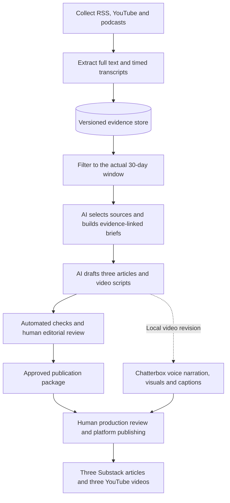

# Problem Set 4 Student Submission

The course instructions remain in [README.md](README.md) and the required contracts in [ARCHITECTURE.md](ARCHITECTURE.md).

**Student:** To complete

**GitHub repository:** https://github.com/harrrisw/ps04

## Topic and Audience

- **Publication name:** The Small Business Research Brief
- **Topic:** AI tools for customer, competitor, and market research on a small-business budget.
- **Audience and assumed knowledge:** Market researchers, marketing generalists, and small-business owners who know basic research methods but have limited time, budget, and technical support.
- **Central question:** Where can AI research tools save small businesses time while producing evidence reliable enough to guide decisions?
- **Scope and exclusions:** Desk research, competitor monitoring, customer-feedback analysis, and interview/survey synthesis. Assess traceability, accuracy, costs, and practical effort. Exclude generic content generation, unsupported ROI claims, and synthetic respondents presented as real customer evidence.
- **Reason for readers to return:** A recurring, evidence-based assessment of which capabilities merit a small pilot and which claims still need validation.

## Published Series

| Piece | Title | Substack article | YouTube video |
| --- | --- | --- | --- |
| 1 | Pilot the Evidence Trail Before Automating Competitor Research | [Read article](https://mingxiwang.substack.com/p/pilot-the-evidence-trail-before-automating) | [Watch video](https://youtu.be/IDsybf7UwEE) |
| 2 | Make AI Research Earn Its Place With Evidence You Can Check | [Read article](https://mingxiwang.substack.com/p/make-ai-research-earn-its-place-with) | [Watch video](https://youtu.be/7iR-6_BBqYQ) |
| 3 | Pilot One Customer Question and Count the Work Needed to Trust the Answer | [Read article](https://mingxiwang.substack.com/p/pilot-one-customer-question-and-count) | [Watch video](https://youtu.be/8oNRSNaHDDU) |

The replacement videos use Chatterbox narration generated from my supplied voice recording and run 4:21, 4:28, and 4:08. Their titles and channel were verified through anonymous YouTube oEmbed on October 17; full external playback was not independently checked. The articles were accessible without sign-in on October 16. Their links to the **replacement** videos still need updating or verification. [Publication mapping](deliverables/20261017-chatterbox/publication_links.json).

**Separate technical demonstration video:** [Watch/download the available 5:43 walkthrough](deliverables/technical-demo/technical-demo.mp4). A revised 5:29 Chatterbox version with the updated architecture is saved locally as `deliverables/20261017-chatterbox/04-video.mp4`; its upload link has not yet been supplied. Both demonstrate saved artifacts rather than a new live run.

## Setup and Execution

Use Bash (Git Bash on Windows) and Python 3.11+; this workspace used Python 3.12.10. Install the collection and transcription dependencies:

```bash
python -m venv .venv
source .venv/Scripts/activate  # Windows Git Bash
# Linux/macOS: source .venv/bin/activate
python -m pip install -r requirements.txt -r requirements-media.txt
export PIPELINE_PYTHON="$(command -v python)"
```

Set the credential environment variable **`PARLEY_API_KEY`** using the [Parley setup instructions](docs/PARLEY.md). The current provider is MIT Parley with `gpt-5.4-mini`; the October 10 run used Codex. Parley account credits and unreported dollar costs are not assumed free. Local transcription uses faster-whisper `base.en`; yt-dlp, Deno, and FFmpeg support media extraction. [Tested dependency versions](requirements-lock.txt) and [full setup instructions](docs/SETUP.md) are retained.

Set topic, audience, provider, and collection options in [config/project.json](config/project.json); edit [config/sources.json](config/sources.json), [config/editorial_policy.md](config/editorial_policy.md), and the four [prompts](prompts/) for the intended sources and editorial rules. Each run snapshots these settings.

```bash
bash run.sh
bash run.sh --package runs/RUN_ID
```

For the published series, replace `RUN_ID` with `20261010T052912Z-1d2e8a`. Packaging requires a matching human approval record; it does not publish automatically. On a fresh clone, `bash scripts/restore_evidence.sh` rebuilds the local index from retained ingestion records. `python tests/test_pipeline.py` runs the offline checks. [Local Chatterbox production](docs/CHATTERBOX_PRODUCTION.md) uses a separate environment.

## Architecture and Manual Handoffs



`run.sh` coordinates the sixteen Bash interfaces through collection and editorial workflows. Focused Python helpers handle parsing, transcription, model calls, and validation. Only the store component accesses the SQLite index; immutable text and transcripts are retained in `data/assets/`. AI calls occur during selection, briefing, article drafting, and script drafting, with requests and responses saved per run. [Component-level implementation](docs/IMPLEMENTATION.md).

Human review uses `REVIEW.md`, `briefs.jsonl`, article/script files, source passages, and `review.json`; a matching `approval.json` permits `prepare_package.sh` to assemble the handoff. Final approval is not yet recorded. The local video path takes saved scripts, visuals, and a private voice sample into Chatterbox and FFmpeg, producing MP4s, captions, and descriptions in the [delivery folder](deliverables/20261017-chatterbox/README.md). It does not establish approval. Google Vids/HeyGen production remains undocumented. Substack and YouTube publication is manual; the resulting links appear above. The voice sample and model weights remain outside Git.

## Evidence and Runs

Retained [source text and timestamped transcripts](data/assets/) support the ignored local index at `data/evidence/index.sqlite3`. Each run retains inputs, configuration, prompts, AI responses, decisions, briefs, draft outputs, checks, and logs. Large media downloads are omitted; use each evidence record's `url` for written/YouTube material or `media_url` for podcast audio. [Retrieval and restoration instructions](docs/SETUP.md).

| Run | Actual date | Run artifacts and logs | Elapsed time | Approximate cost |
| --- | --- | --- | --- | --- |
| First principal live run — published series | October 10, 2026 | [Run 1d2e8a](runs/20261010T052912Z-1d2e8a/) · [Summary](runs/20261010T052912Z-1d2e8a/summary.json) | 672.327 seconds | Unknown; provider dollar cost unreported |
| Second principal live run — Parley rerun | October 16, 2026 | [Run 231399](runs/20261016T153525Z-231399/) · [Summary](runs/20261016T153525Z-231399/summary.json) | 559.25 seconds | Unknown; provider dollar cost unreported |

Elapsed times sum active stage work, including retries, rather than pauses between sessions. October 16 work is after the supplied October 13 deadline. Earlier and partial attempts remain in the [complete run inventory](docs/RUNS.md).

Run 1 had **39 eligible items from nine publishers** (35 written, two YouTube, two podcast), with 13 accepted, 23 rejected, and three deferred. Run 2 had **60 eligible items from nine publishers** (55 written, three YouTube, two podcast), with 15 accepted, 30 rejected, and 15 deferred. Both reached three articles and scripts after documented assistant edits; the later drafts were not published. Policy, source coverage, provider, and date window changed, so the [run comparison](runs/20261016T153525Z-231399/feedback_comparison.md) does not isolate the policy's causal effect.

- **Decisions, briefs, and checks:** [Run 1 review packet](runs/20261010T052912Z-1d2e8a/REVIEW.md) and [Run 2 review packet](runs/20261016T153525Z-231399/REVIEW.md) link the outputs and supporting evidence.
- **Duplicate handling:** The separately labeled [28-item replay](runs/20261010T052041Z-15fd8c/replays/store-e46554b8/replay.json) returned every item unchanged and preserved the logical item count and latest versions. It is not another live date. Run 2's two new and 38 unchanged ingestion records refer to its immediate starting index, not the October 10-to-16 difference.
- **Freshness:** [Run 1 exclusions](runs/20261010T052912Z-1d2e8a/exclusions.jsonl) and [Run 2 exclusions](runs/20261016T153525Z-231399/exclusions.jsonl) preserve reasons for excluding material from the actual 30-day window.
- **Failure and recovery:** [Initial collection attempt](runs/20261010T051736Z-21091d/) retains collection/transcription failures. [Parley attempt](runs/20261016T043111Z-b61328/) records the unsupported model alias, followed by later runs with a supported model. [Citation repairs](runs/20261016T153525Z-231399/assistant_edits/brief_repair/README.md) preserve assisted recovery after generated quotations failed validation. Offline test fixtures are separate from this live evidence.

**Published claim trace:** Article 1 attributes access to underlying text and source links to Crayon. Brief claim `01-C01` cites accepted item `feed:32944883b9dff85a7148008d`, version `b192c0ca1da12bd242489506681f276f83473000ed4152d9795eac13ccc33ed1`, with the exact passage “Ask for more and you get the full text and source link.” The [complete trace](docs/CLAIM_TRACE.md) links the published article, brief, acceptance decision, immutable source text, and original URL. It supports an attributed capability claim, not proven effectiveness.

## Editorial Review

The [six-item review record](runs/20261010T052912Z-1d2e8a/human_review_sample.md) preserves my original comments, expanded explanations, item/version identifiers, and AI decisions. My judgments agreed with these six decisions:

| Decision | Item | My judgment compared with the AI decision |
| --- | --- | --- |
| Accept | NN/g — Empathy Mapping | Agree: translates research theory into a workflow connecting findings to evidence; does not prove time savings. |
| Accept | Crayon — Insights API | Agree: offers a concrete competitor-data capability to inspect; affordability and effectiveness still need testing. |
| Accept | Marketing AI Institute — Fact-checking agents | Agree: an intriguing, inspectable multi-agent workflow; agent agreement still requires source verification. |
| Defer | Crayon — Competitive Enablement | Agree: the framework and reported outcome associations need stronger methods before supporting causal claims. |
| Defer | Christopher Penn — Lexical-Semantic Fusion | Agree: speed and cost claims need a worked comparison, named baseline, and total-effort measurements. |
| Defer | The Artificial Intelligence Show — Episode 245 | Agree: hypothetical applications and announcements do not yet establish a tested research workflow. |

Compare the [before policy](runs/20261010T052912Z-1d2e8a/config/editorial_policy.md) with the [after policy](runs/20261016T153525Z-231399/config/editorial_policy.md). Version 3 implements my October 16 feedback: favor inspectable workflows, distinguish attributed capabilities from measured outcomes, and require baselines for speed/cost claims. Exact prompts are retained in [Run 1](runs/20261010T052912Z-1d2e8a/prompts/) and [Run 2](runs/20261016T153525Z-231399/prompts/); the [comparison](runs/20261016T153525Z-231399/feedback_comparison.md) records affected decisions and arguments.

[Assistant citation corrections](runs/20261016T153525Z-231399/assistant_edits/brief_repair/README.md) and [copy edits](runs/20261016T153525Z-231399/assistant_edits/content_copy_edit/README.md) preserve original and corrected outputs. They are separate from my source judgments. Commercially weighted, English-language evidence limits generalization to small businesses. Source/audio verification and final approval remain unrecorded; passing mechanical checks and uploading videos do not substitute for those steps. [Approval procedure](docs/HUMAN_REVIEW.md).

## Reflection

One insight that I found while producing this system is that reliable AI-generated research depends as much on evidence management and review as on text generation. Preserving source versions, editorial decisions, and intermediate outputs made it possible to trace claims and identify where errors entered the pipeline. One limitation was that generated briefs still contained inaccurate or misattributed quotations after an automated correction attempt, showing that successful execution does not guarantee trustworthy content. My next improvement would be to strengthen claim-level validation before drafting, so unsupported claims are flagged earlier and require less downstream correction. Architecturally, separate Bash interfaces make stages independently runnable and easier to debug, while focused Python components handle processing and a versioned SQLite store supports deduplication and traceability. The tradeoff is additional maintenance, as a fresh clone must rebuild the local index, and cached media needs freshness checks to prevent outdated material from being reused.
