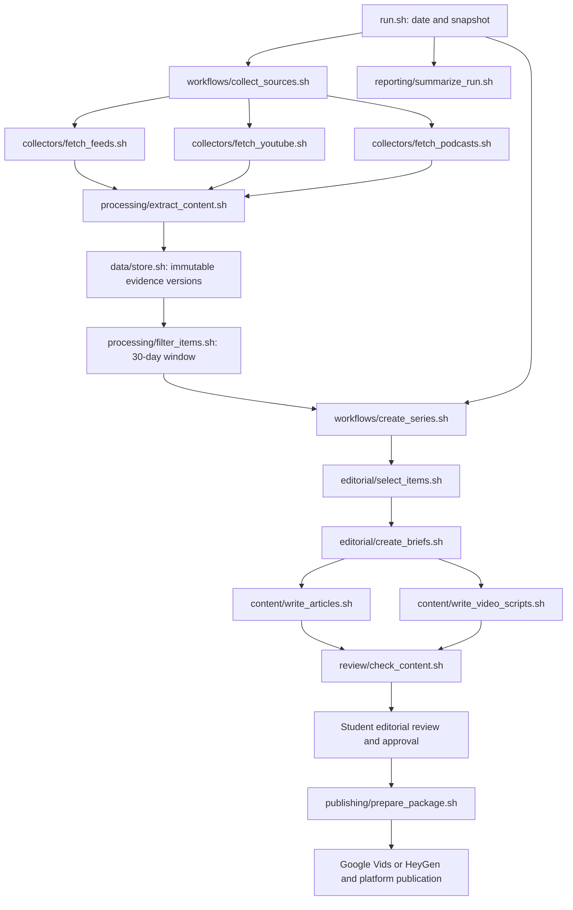
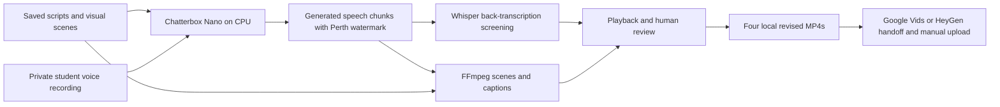

# Implemented pipeline architecture

Run `bash run.sh` from the repository root. The course contracts remain unchanged
in [ARCHITECTURE.md](../ARCHITECTURE.md) and [README.md](../README.md).

The diagram is Mermaid source retained in Git and rendered by GitHub. All sixteen
required Bash files have their original responsibilities. Each substantive stage
calls its own Python implementation; `lib/` contains runtime, record, and model
transport helpers rather than a hidden whole-pipeline implementation.

The collectors emit JSON Lines. Extraction retrieves full written text or
timestamped media transcripts; local Whisper avoids YouTube's rate-limited subtitle
endpoint. Only `data/store.sh` and `data/store.py` access the SQLite index. Other
components use the store's commands. Source files and immutable transcripts are
retained in `data/assets/`; the ignored index can be reconstructed using
`bash scripts/restore_evidence.sh`.

Selection, briefing, article generation, and script generation call the configured
LLM. The October 10 series used Codex; the completed October 16 series used MIT
Parley with `gpt-5.4-mini` and documented assistant corrections. Exact requests,
responses, schemas, and usage are retained under each run's `ai_calls/` directory.
Failed attempts remain recorded. Dollar cost stays unknown when the provider does
not report it; account credits are not assumed free.

Checks validate source eligibility, exact quotations, transcript segments,
independent-publisher coverage, and claim markers. They do not prove semantic
correctness. Packaging requires a matching human approval fingerprint. Publishing
outside the package flow is recorded as an external student action and does not
create or backdate approval.

See [all retained runs](RUNS.md), [published claim traces](CLAIM_TRACE.md),
[setup](SETUP.md), and [evaluation audit](EVALUATION.md).

## Local voice-cloned video revision — October 17

The [Chatterbox production workflow](CHATTERBOX_PRODUCTION.md) adds a local media
revision path after the saved scripts. It does not change the sixteen research
components, modify the historical evidence, or create editorial approval.

The reference recording and model files remain in ignored `.tools/`; large video
revisions remain local. Synthetic voice narration is disclosed. Original public
uploads retain their existing links until replacement uploads are provided.
